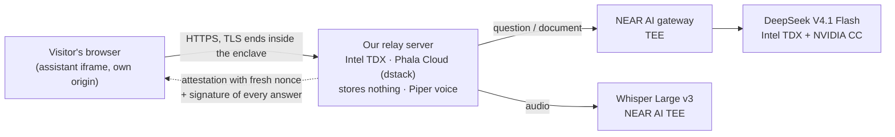

# Sir Near — a verifiably private voice assistant for any website

**NEAR HACKATHON · Tracks: Privacy & Private AI (`privacy`), Open Innovation (`open`)** · NEAR AI Cloud · Phala Cloud (dstack) · TEE attestation

[](https://github.com/buterbro-cell/knight-site/actions/workflows/test.yml) · For AI reviewers: [`AGENTS.md`](AGENTS.md) (every claim → the code and test that prove it) · [`llms.txt`](llms.txt)

> Website chatbots of clinics and banks usually tell you **not** to share medical or financial details — the conversation is stored by an AI vendor.
> Sir Near is built so there is nothing to store and nobody to see it: every hop runs in a hardware enclave, and the assistant **proves it on screen**.

| | |
|---|---|
| 🌐 **Live demo** | https://4f6208e0cb5e85944797f12cb210582e54a2107f-3000.dstack-pha-prod9.phala.network |
| 🏥🏦 **Demo businesses** | `/demo/?s=clinic` · `/demo/?s=bank` |
| 🛡️ **Server attestation (Phala Trust Center)** | https://trust.phala.com/app/a8fa8d779fbe978b9ed7ffda75e01abc952f7ee9 |
| 🧪 **Live self-test** | `/api/selftest` — the minimal verify script, run on the deployed server |

---

## For judges: 5 minutes, do X → see Y

1. **Open `/demo/?s=clinic`** → tap **Private assistant** (bottom right) → **Talk to the assistant**.
   → A 3D knight greets you by voice as Daisy Clinic's assistant; under the title: **✓ Official assistant on <this site>**.
2. Tap **Document** → **📸 Photo of a blood test** (fictional patient) → type a question or just tap **Ask**.
   → The model reads the photo inside the TEE. The knight names the out-of-range values (hemoglobin, ferritin, vitamin D, LDL, HbA1c, CRP), explains them in plain words and suggests which of the clinic's doctors to see. Under the answer: **🔏 Answer signed inside the TEE — verified**.
3. Tap **TEE ✓** in the assistant's header → the **Verified panel**.
   → Green checks for the **model** (Intel TDX + NVIDIA GPU), the **NEAR AI gateway** and **our relay server** (Intel TDX on Phala), plus the signature evidence of the last answer.
4. In the panel, under **Check it yourself**, type **any number** → **Verify**.
   → "✅ Your number was found inside the Intel-signed report": `nonce = sha256(your number)` sits in the quote's `report_data`. Nobody could have prepared that report in advance — the check is live. Check the hash yourself: `echo -n "<your number>" | sha256sum`.
5. Switch to **🏦 Owlbridge Bank** at the top → **Document** → **Suspicious call from "the bank"** → **Ask**.
   → It recognises the "safe account" scam (urgency, SMS code, secrecy) and says exactly what to do now. **Document** → **Personal loan offer** → the advertised 6.9% is really a **15.8% APR** (financed insurance, fees, early-repayment penalty).
6. Open **`/api/selftest`**.
   → The output of `scripts/verify.js` produced live on the deployed server: TEE model chosen from `/v1/models` → one completion → attestation with a fresh nonce → response signature. All ✅.
7. Open the **Trust Center** link above.
   → Phala's independent report for our server: TEE hardware verified, source code (compose) verified, network end-to-end encrypted, OS verified.
8. **Don't trust our site at all:** `git clone`, put your own key in `.env`, run `npm run verify` — it talks to NEAR AI directly with its own random nonce.

---

## The problem

Clinics, banks and insurers are putting AI assistants on their websites. But the assistant's terms — and often the assistant itself — ask people **not** to share sensitive details, because conversations go to an AI vendor and are stored. So the assistant can't help with exactly the questions people need help with: symptoms they're embarrassed about, a payment they can't make, whether a call "from the bank" was a scam.

## What we built

**Sir Near** is a voice assistant with a live 3D character that any business adds to its website with **one line of code**. Visitors talk to it or show it a document; it answers out loud. Everything that touches the visitor's data runs in Trusted Execution Environments, and the assistant shows the proof.



- 🎙️ **Voice → text:** Whisper Large v3 in a NEAR AI TEE.
- 🧠 **Answers:** `deepseek-ai/DeepSeek-V4.1-Flash-1017`, hosted by NEAR AI in a TEE (*Private TEE*).
- 🔊 **Text → voice:** Piper, inside our TEE relay — same voice on every device.
- 🛡️ **Verified panel:** model, gateway and relay attestations, each with a fresh nonce; every answer signed in the enclave.
- 🗑️ **Nothing stored** — see below.
- 🧸 **A character people like talking to:** rigged 3D knight with 20 animations, a face that blinks and talks only while the voice plays, and Talking-Tom-style reactions (tap him, tickle him, poke him five times and he falls over).

## Add it to a website — one line

```html
<script src="https://<assistant-host>/widget.js" data-biz="clinic" data-lang="en" async></script>
```

- `public/widget.js` adds a button in the corner. The assistant opens in an **iframe from our origin**, so the host page **cannot read** the conversation — not the voice, not the documents, not the answers.
- Each business is one **public** JSON file, `public/biz/<id>.json`: name, greeting, background, sample documents, allowed domains and the exact instructions the assistant follows. Public on purpose — anyone can read what the assistant was told. Business profiles use no outside tools: nothing leaves the TEE model call.
- **Official-install badge:** the assistant checks the embedding page's origin (the iframe referrer, which the host page cannot change) against the profile's `domains` and shows *✓ Official assistant on …* or a warning. The host page cannot draw over it.

## Requirements → where they are

| Track requirement | Where |
|---|---|
| NEAR AI Cloud via the OpenAI-compatible API, base URL `https://cloud-api.near.ai/v1`, key in `.env` | `server.js` (`API_URL`), `lib/env.js`, `.env.example` |
| Choose a TEE-hosted model from the models endpoint | `server.js → checkModel()` reads `/v1/models`, prefers NEAR-hosted *Private TEE* models (`MODEL_PREFS`), never *Incognito*; same in `lib/selftest.js` |
| Fetch the attestation report with a fresh random nonce and verify it as the docs describe | `lib/attest.js → attest()` — a port of the official [nearai-cloud-verifier](https://github.com/nearai/nearai-cloud-verifier) |
| Show a "Verified" panel listing what was checked | **TEE ✓** button → panel (`public/app.js → renderVerified()`); line under every answer |
| Keep nothing server-side after a response returns; say so in README and code | header comment of `server.js`; section *Nothing is kept server-side* below; `/api/health → storesUserData:false, keepsAtRest` (only the owner's encrypted standing orders) |
| Fictional sample documents | `public/samples/` — blood test (also as a photo), clinic invoice, card statement, loan offer, scam-call transcript, receipts, lease |
| Minimal script: one completion + attestation, show its output | `scripts/verify.js` (`npm run verify`); real output below and live at `/api/selftest` |

## What is verified

**Model and NEAR AI gateway** — `GET /v1/attestation/report?model=…&nonce=<32 random bytes>&signing_algo=ecdsa`:

1. **Intel TDX quote is genuine** — `@phala/dcap-qvl-node` against Intel's collateral (`UpToDate`/`OutOfDate` accepted, as in the official verifier).
2. **Signing key is bound to the enclave** — `report_data[0..32]` = attested signing address.
3. **Report is fresh** — `report_data[32..64]` = our nonce.
4. **NVIDIA GPU in confidential-computing mode** — GPU evidence carries our nonce; NVIDIA NRAS verdict `true`.
5. **Running code matches the manifest** — SHA-256 of the docker compose = `mr_config_id` (informational).

**Every answer** — `GET /v1/signature/{chat_id}`:

6. SHA-256 of our exact request body and of the exact streamed response match the signed text.
7. The ECDSA signature recovers to the signing address.
8. That address belongs to an attestation we just verified (if another replica answered, that key is attested with a new nonce).

**Our relay server** — `GET /api/attestation/self` (`lib/selfattest.js`), dstack guest agent:

9. Intel TDX quote with `report_data = tag ‖ our nonce`, verified with dcap-qvl; app id and compose hash measured in RTMR3; public report on the Phala Trust Center.

## Nothing is kept server-side

- No database, no content logs, no conversation files. **One exception, created only by the owner of an agent wallet:** standing orders (DCA, "buy NEAR for 1 USDT every day") — owner account, tokens, amount, period, runs left, the last results. They are kept in one file encrypted with AES-256-GCM under a key derived from the TEE root (`lib/dca.js`), so the file is unreadable outside this attested app; no questions, answers or balances go there. `test/privacy.test.js` enforces that no other code writes files. Questions, answers, documents and audio live only in local variables of one request handler.
- No answer cache, no TTS cache, no conversation history on the server — the browser keeps the last few turns.
- Documents are read **in the browser** (PDF via pdf.js) and sent only together with the question. Photos and screenshots are shrunk in the browser (≤ 1344 px JPEG) and go as an image straight to the TEE model (DeepSeek V4.1 Flash reads images natively) — never stored.
- **No cloud fallbacks in the browser:** voice input goes only to Whisper in the TEE (the browser's own speech recognition — Google / Apple — is never used); voice output falls back only to voices that run **on the device**.
- In memory, without user content: salted IP hashes with timestamps for rate limiting (salt changes on every restart), aggregate token counters for the owner's `/dev.html`, the latest attestation results.
- Web search is **off** by default (it would send a query outside the TEE).

## What it proves — and what it doesn't

| Hop | Runs in | Proof |
|---|---|---|
| Our relay server (this repo) | Intel TDX CVM, Phala Cloud (dstack) | panel → "Our relay server"; [Trust Center](https://trust.phala.com/app/a8fa8d779fbe978b9ed7ffda75e01abc952f7ee9); raw quote `/api/attestation/self?raw=1` |
| NEAR AI gateway | TEE | gateway attestation in the panel |
| Model and Whisper | Intel TDX + NVIDIA confidential computing | model attestation + signature of every answer |

- **Which code runs:** `docker-compose.phala.yml` pins the image **by digest**; GitHub Actions (`.github/workflows/image.yml`) builds it from a public commit with build provenance; the compose hash is measured into RTMR3 and shown on the Trust Center.
- **Attestation proves *where* an answer was computed and that nobody altered it — not that the answer is correct.** The model can be wrong; the assistant says so and doesn't diagnose.
- **Not covered:** the visitor's own device; a malicious page drawing a *fake* assistant (it can't read the real one, and the real one shows the official-install badge and its own origin); trust in Intel, NVIDIA, Phala and NEAR AI hardware roots; side-channel and physical attacks on TEEs. This is a prototype without an external security audit.

## Business model and verifying installations

- **Subscription per business** by number of conversations (for example 500 conversations / month), the server counts **only how many** conversations happened — never their content. Larger customers could bring their own NEAR AI key or run the open-source relay in their own TEE (not built yet).
- **Cost:** one conversation is ~1–2 cents of model usage on NEAR AI; one TEE relay serves many businesses (each is a JSON profile).
- **Checking installs:** the official-install badge (above); for self-hosted relays the operator — or anyone — checks the relay's attestation and that its compose pins the published image digest.

## Roadmap — not built yet

- **Voice transactions in your own wallet:** confirmed by voice, with no tap.
- **Top up from other chains:** USDT on BNB, ETH, Solana or TRON → the agent balance, through a NEAR Intents deposit address.
- **Notifications** for scheduled purchases and limit orders.
- **Agent-to-agent:** the agent hires other agents and pays for APIs, data and compute.
- **On-chain limits for the agent wallet** (a policy contract), on top of the limits enforced in the TEE.
- **Bring-your-own relay:** a business runs the open-source relay in its own TEE and the assistant verifies it the same way it verifies ours.

## Private payments (NEAR Intents, confidential)

| Where | What happens |
|---|---|
| **Personal agent** (main page) and **bank** | Say or type "send 2 USDT to anna.near" / "swap 3 NEAR to USDT" (NEAR and USDT; if you lack the token, pay with the other — it is exchanged privately on the way). The model in the TEE calls `prepare_payment`, a card shows recipient, amounts, fee and time, and **your own wallet** (HOT, Meteor… via NEAR Connect) signs. It works like near.com: the money sits on your own balance inside NEAR Intents (one wallet transaction tops it up when it is short), and each payment is an intent your wallet signs, with no gas. The payout lands on the recipient's **private** Confidential Intents balance, so the ledger does not show whom you paid. Nothing moves without your signature. |
| **Clinic: paid private review** | A review of *your own* lab results costs 1 USDT, paid confidentially to the clinic (`ro52.near`): the clinic is paid, but your wallet is not linked to the payment. The server unlocks the answer only after checking the payment itself. The fictional samples stay free. |
| **Recurring purchases (DCA)** | Say "buy NEAR for 1 dollar every day": the assistant repeats the plan, and after your "yes" the agent wallet buys on schedule — the first purchase at once, then every period, privately through NEAR Intents, within the same limits. "Show my plans" / "cancel it" by voice or in the agent window. Three failures in a row (e.g. no USDT left) pause the plan. |
| **Limit orders** | "Buy NEAR for 5 dollars if the price drops below 2": one purchase from the agent wallet when the NEAR price (from NEAR Intents) crosses the level, checked every minute, valid 30 days by default. Same confirmation and limits as DCA. |
| **Contacts** | "Save ro52.near as Clinic", then "send Clinic 1 USDT". Contacts live **only on your device** (localStorage) and travel with a question to the TEE model; the address is checked on chain before saving. A saved contact named in the request needs no spelling-out. |
| **Payment requests** | "Ask Anna for 3 USDT": a link and a QR code; whoever opens it gets a private-payment card to your address (NEAR Intents, their own wallet signs). |
| **"What did I spend this week?"** | Answered from a 30-day log kept on your device plus the agent's plan results; nothing is stored on the server for this. |
| **The agent buys a service** | In the clinic, "⚡ From agent wallet" pays for the private lab-results review from the agent's own balance — an AI agent paying for data/compute by itself; the server unlocks the answer after checking that payment. |
| **Home-screen app** | Installable (PWA): own icon, full screen. The service worker caches nothing. |
| **Full mode** (personal agent) | An **agent wallet** whose key exists only inside our TEE (Phala dstack `GetKey`, one per owner, never stored). You top it up with a small budget (the top-up is itself a confidential payment onto the agent's private Intents balance); the agent then pays on your voice command **without a wallet popup and without gas** — it signs intents with its TEE key — within $10 per action and $25 per day. Only you can command it: a NEP-413 message signed by a full-access key of your account opens a 24-hour session on your device. "Send everything back to me" is one tap, needs no signature (it can only pay you) and lands on your private Intents balance. |

Not covered and stated plainly: the top-up of your Intents balance from your wallet is a public transaction; amounts and timing are visible to NEAR Intents; the full-mode daily counter resets on restart; a new attested version of the relay derives the same agent keys. Demo limits: $50 per wallet-signed action. Details: [`docs/THREAT_MODEL.md`](docs/THREAT_MODEL.md) rows 11–14.

## Check it without a NEAR AI key

```bash
npm install
npm test        # unit tests; GitHub Actions runs them on every push
```

| Test file | What it proves |
|---|---|
| `test/attest.test.js` | Attestation checks: the signing key is bound to the quote, the nonce makes it fresh (a replayed report fails), the compose hash = mr_config_id. Per-answer signatures: an edited answer, an edited question, a forged signature and a valid signature from a non-attested key are all rejected. |
| `test/input.test.js` | Documents and photos are attached only to the current question, wrapped as data with the anti-injection rule; only jpeg/png/webp data URLs ≤ 1.4 MB; system/tool roles from the browser are dropped. |
| `test/ratelimit.test.js` | Per-visitor budgets per action, daily cap, window refill; memory holds no IP addresses (only salted hashes), new salt per process. |
| `test/privacy.test.js` | The server code has no file writes, no database clients, and no log line that prints questions, answers, documents or audio. |

**A real answer you can re-check offline.** [`evidence/`](evidence) holds a signed answer from the TEE model captured on the live server (`/api/selftest?bundle=1`): the exact request and response bytes, the enclave signature, the raw attestation report and Intel's collateral. No key, no network, no trust in our server:

```bash
node scripts/verify-bundle.js evidence/2026-11-05-deepseek-v4.1-flash.json
```

It checks the signature, the request/response hashes, the Intel TDX quotes (evaluated at capture time), the key binding, the nonce and the compose hash. CI runs it on every push, and the tests confirm that an edited answer or a different nonce fails. The NVIDIA GPU verdict needs NVIDIA's online service, so that one is in the live check (`npm run verify`).

Threats and defences, each mapped to code and tests: [`docs/THREAT_MODEL.md`](docs/THREAT_MODEL.md).

## Run it

```bash
cp .env.example .env        # NEAR_AI_KEY=...
npm install
npm run verify              # minimal script: one completion + attestation + signature
npm start                   # http://localhost:3000  (demo: /demo/)
```

- **Docker / any host:** `Dockerfile` (`--build-arg WITH_VOICE=1` adds the Piper voice).
- **In a TEE (Phala Cloud):** GitHub Actions publishes `ghcr.io/buterbro-cell/knight-site`; deploy `docker-compose.phala.yml` and set `NEAR_AI_KEY` as an encrypted secret. The dstack socket mount lets the server attest itself.

### Real output of the minimal script (captured on the deployed server, Nov 1 2026)

```
$ node scripts/verify.js   (run live on this server, 2026-11-01T23:40:31.963Z)

1) Model: deepseek-ai/DeepSeek-V4.1-Flash-1017  (from 64 models on /v1/models)

2) Completion id: chatcmpl-2163a327-174d-4c4c-b26e-4d183f17a32d
   Answer: A TEE (Trusted Execution Environment) is a secure, isolated processing area that protects sensitive code and data from the main operating system and other applications.

3) Attestation (fresh random nonce)…
   nonce: 7039cfc3a00b62a69ce1d816ff1fbe27a08ed6d39e40a6358531ce0d87950b5b

   Gateway — signing address 0xb98a789cdc4817275f5155593ba73ef2a957e779
     ✅ Intel TDX quote is genuine  (dcap-qvl status: UpToDate)
     ✅ Signing key is bound to this enclave
     ✅ Report is fresh (our nonce inside the quote)  (report_data[32..64] = 7039cfc3a00b62a6…)
     ✅ Running code matches the attested manifest  [info]

   Model #1 — signing address 0xfe0071895500a9755c18044948ab4f4e1a7f337e
     ✅ Intel TDX quote is genuine  (dcap-qvl status: UpToDate)
     ✅ Signing key is bound to this enclave
     ✅ Report is fresh (our nonce inside the quote)  (report_data[32..64] = 7039cfc3a00b62a6…)
     ✅ Running code matches the attested manifest  [info]
     ✅ GPU evidence uses our nonce
     ✅ NVIDIA GPU is in confidential-computing mode  (NVIDIA NRAS verdict: true)

   Attestation overall: ✅ VERIFIED  (2054 ms)

4) Response signature…
     ✅ Question reached the enclave unchanged
     ✅ Answer left the enclave unchanged
     ✅ Signature is valid  (signer 0xfe0071895500a9755c18044948ab4f4e1a7f337e)
     ✅ Signer is an attested TEE key

Nothing was stored: this script only printed results.
```

Full output: [`docs/verify-output.txt`](docs/verify-output.txt).

## Repository map

| Path | What |
|---|---|
| `server.js` | API: streamed answers, Whisper, Piper, proofs, rate limits; stores nothing |
| `lib/attest.js` | NEAR AI attestation + answer-signature verification |
| `lib/selfattest.js` | attestation of our own server via the dstack guest agent |
| `lib/selftest.js`, `scripts/verify.js` | the minimal end-to-end check (`npm run verify`, `/api/selftest`) |
| `lib/input.js` | chat input: documents and photos as data, anti-injection wrapper |
| `lib/ratelimit.js` | per-visitor budgets with salted IP hashes only |
| `lib/bundle.js`, `scripts/verify-bundle.js` | evidence bundles (`/api/selftest?bundle=1`) and their offline re-check |
| `test/`, `.github/workflows/test.yml` | unit tests and CI |
| `docs/THREAT_MODEL.md` | threats, defences, code and tests, what is not covered |
| `public/vendor/pdfjs/` | pdf.js served from our origin (Apache-2.0) |
| `lib/pay.js`, `public/wallet.js`, `public/vendor/near-connect/` | private payments: confidential NEAR Intents quotes, wallet signing (NEAR Connect, MIT) |
| `lib/agentwallet.js`, `lib/near.js` | full mode: agent wallet with a TEE-only key; zero-dependency NEAR transactions and NEP-413 (bytes checked against near-api-js in CI) |
| `tools.js` | optional public lookups for the main knight (NEAR docs, network status) |
| `public/index.html`, `public/app.js`, `public/app.css` | the assistant: voice, Verified panel, documents, business profiles |
| `public/knight3d.js`, `public/3d/` | the 3D character (three.js), model, face |
| `public/widget.js` | one-line embed for business websites |
| `public/biz/*.json` | business profiles (clinic, bank) |
| `public/demo/index.html` | fictional clinic and bank websites with the assistant embedded |
| `public/samples/` | fictional documents |
| `Dockerfile`, `docker-compose.phala.yml`, `.github/workflows/image.yml` | build and TEE deployment |
| `README.ru.md` | short guide in Russian |

## Built during the hackathon, and with what

- All code in this repository was written during NEAR HACKATHON (first commit Nov 1, 2026); full history in git.
- Written with an AI coding agent (Claude Code); the team designed the product, the character and its animations.
- Libraries: three.js (3D), pdf.js (PDF reading in the browser, vendored), `@phala/dcap-qvl-node` (Intel TDX quote verification), `ethers` v5 (signature recovery), Piper TTS (voice). 3D character generated with Tripo and animated with Adobe Mixamo; backgrounds AI-generated.
- License: MIT (`LICENSE`).

All businesses, people and documents in this repository are fictional.

Built for **NEAR HACKATHON** (Nov 1–14, 2026), track **Privacy & Private AI**.
